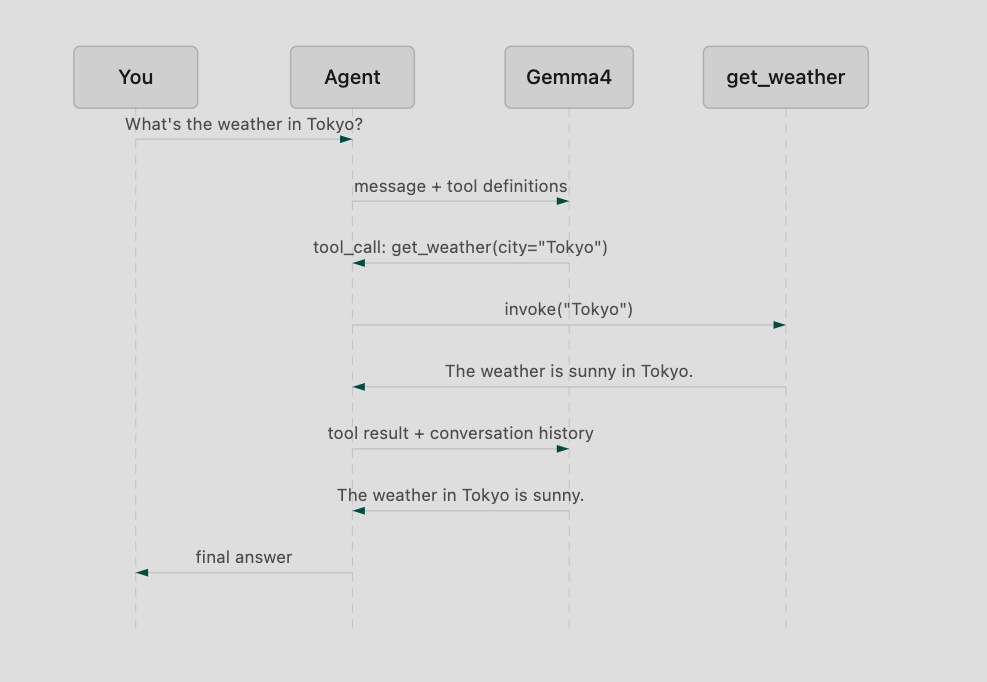

# local_ai

Tool-calling agent experiments: the same "model decides to call a Python function" loop, built a few different ways, with a local model (Gemma 4 via [Ollama](https://ollama.com)) and with Claude.



## Scripts

| Script | Model | Approach |
|---|---|---|
| `gemma_tools.py` | Gemma 4 (Ollama) | Single hard-coded question; raw `ollama.chat` with one tool (`calculate_shipping`) |
| `runner.py` | Gemma 4 (Ollama) | Interactive chat loop; auto-registers every function in `my_tools.py` as a tool |
| `ollama_agent.py` | Gemma 4 (Ollama) | LangChain `create_agent` with one `@tool` (`get_weather`); the diagram above |
| `claude_agent.py` | Claude Sonnet 5.5 (Anthropic API) | Interactive LangChain agent using the tools in `my_tools.py` |
| `my_tools.py` | — | Mock tools (`fetch_local_weather`, `search_text_file`) shared by `runner.py` and `claude_agent.py` |

## Setup

```bash
cd local_ai
uv sync
```

- **Ollama scripts:** install Ollama, then `ollama pull gemma4`.
- **`claude_agent.py`:** needs `ANTHROPIC_API_KEY` set.

## Run

```bash
uv run gemma_tools.py
uv run runner.py          # type 'exit' to quit
uv run ollama_agent.py
uv run claude_agent.py    # type 'exit' to quit
```

## Adding tools

Add a typed, docstringed function to `my_tools.py`. `runner.py` and `claude_agent.py` pick it up automatically; the type hints and docstring are what the model sees.
